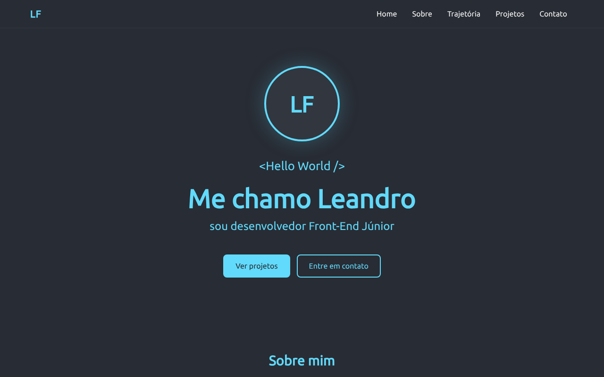
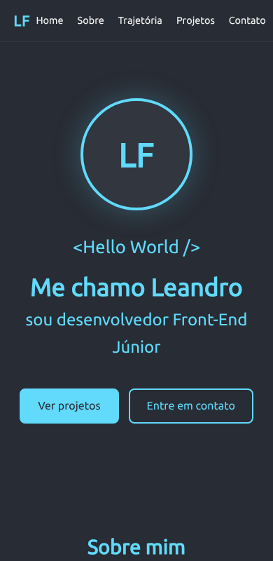

<div align="center">


[](https://github.com/LeandroFeitozaGnu)
[](https://www.linkedin.com/in/leandrofeitoza)
[](https://leandrofeitozagnu.github.io)

</div>

## 👋 Olá, eu sou o Leandro

Desenvolvedor Front-End Júnior. Depois de uma larga experiência profissional como **Suporte Técnico**, em 2020 resolvi mudar para a área de desenvolvimento Web. Em junho de 2020 comecei a estudar na **Trybe** e, em dezembro de 2020, me formei como Desenvolvedor Front-End Júnior.

Procuro uma oportunidade de iniciar a carreira de desenvolvedor e continuar aperfeiçoando as minhas habilidades de Dev.

## 🖥️ O site

Este repositório é o código do meu site pessoal: **https://leandrofeitozagnu.github.io**

<div align="center">


&nbsp;


</div>

O site tem as seções **Home**, **Sobre**, **Trajetória**, **Projetos** e **Contato**, é responsivo e usa a foto de perfil do meu GitHub.

## 🧭 Trajetória

```text
Suporte Técnico ──▶ 2020: virada para Web ──▶ Jun/2020: Trybe ──▶ Dez/2020: Front-End Júnior ──▶ 2021: rumo ao Full-Stack
```

## 🛠️ Feito com


## 🚀 Rodando localmente

```bash
git clone https://github.com/LeandroFeitozaGnu/leandrofeitozagnu.github.io.git
cd leandrofeitozagnu.github.io
yarn install
yarn start      # http://localhost:3000
```

Outros comandos: `yarn build` (build de produção) e `yarn test`.

> O projeto usa `react-scripts` 4, que funciona com **Node 16**. Em versões mais novas do Node o build falha.

## 📦 Publicação

A cada push na branch `master`, o workflow [`deploy.yml`](.github/workflows/deploy.yml) gera o build e publica no GitHub Pages. Para isso, em **Settings → Pages**, a opção **Source** precisa estar como **GitHub Actions**.

## 📫 Contato

- GitHub: [@LeandroFeitozaGnu](https://github.com/LeandroFeitozaGnu)
- LinkedIn: [/in/leandrofeitoza](https://www.linkedin.com/in/leandrofeitoza)
