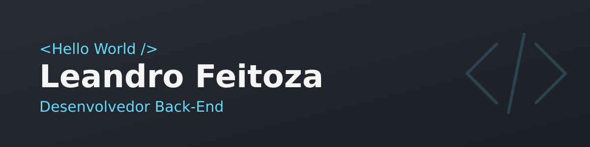
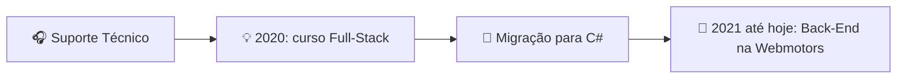

<div align="center">



# E aí, eu sou o Leandro 👋

### Desenvolvedor Back-End, C# no coração e café na veia ☕

[](https://github.com/leandroFeitoza81)
[](https://www.linkedin.com/in/leandrofeitoza)
[](https://leandrofeitoza81.github.io)

</div>

---

## 🚗 Quem sou eu

Desenvolvedor **Back-End** na **Webmotors** desde 2021, trabalhando com **C#** e **.NET**, bancos relacionais e **AWS**.

Antes disso, passei muito tempo no **suporte técnico**. Essa bagagem me ensinou a olhar o problema pelo lado de quem usa o sistema. Em 2020 resolvi mudar de área, fiz o curso Full-Stack e depois migrei de vez para o Back-End com C#.

## 🧰 Minha caixa de ferramentas


## 🛣️ A estrada até aqui



## ⭐ Projetos que mais gosto

| Projeto | Link |
| --- | --- |
| 🪒 **yake-shave** | [ver código](https://github.com/leandroFeitoza81/yake-shave) |
| 🧱 **webapi-default** | [ver código](https://github.com/leandroFeitoza81/webapi-default) |

Tem mais coisa no meu [GitHub](https://github.com/leandroFeitoza81?tab=repositories).

## 🖥️ Sobre este repositório

Aqui mora o código do meu site pessoal: **https://leandrofeitoza81.github.io**

Seções: **Home**, **Sobre**, **Skills**, **Trajetória**, **Projetos** e **Contato**. É responsivo e puxa a foto de perfil direto do GitHub.


## 🚀 Quer rodar na sua máquina?

Precisa de Node 20.19 ou mais novo (o `.nvmrc` indica o 24).

```bash
git clone https://github.com/leandroFeitoza81/leandrofeitoza81.github.io.git
cd leandrofeitoza81.github.io
npm install
npm run dev      # http://localhost:5173
```

Outros comandos:

| Comando | O que faz |
| --- | --- |
| `npm test` | roda os testes com Vitest |
| `npm run build` | gera o build de produção em `dist/` |
| `npm run preview` | serve o build local para conferir |

## 📦 Como vai pro ar

A cada push na `master`, o workflow [`deploy.yml`](.github/workflows/deploy.yml) roda os testes, gera o build e publica no GitHub Pages. Se um teste quebrar, o deploy não acontece.

Para funcionar, em **Settings → Pages** o **Source** precisa estar como **GitHub Actions**.

## 📫 Bora conversar?

- 💼 LinkedIn: [/in/leandrofeitoza](https://www.linkedin.com/in/leandrofeitoza)
- 🐙 GitHub: [@leandroFeitoza81](https://github.com/leandroFeitoza81)

<div align="center">

Feito com ☕ e um pouco de React 😉

</div>
